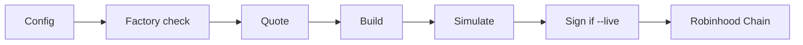

# Pons Bundler

A local command-line tool for launching a token on Pons V2 (Robinhood Chain, chain id 4663) and buying it in the same transaction.

This project is unofficial and is not affiliated with Pons or Robinhood.

## What it does

Pons charges a decaying snipe tax (`currentSnipeTaxBps`) at the start of a launch. A wallet that is not exempt can lose about 99% of its spend in the first seconds.

`launchAndBuy` creates the token and places the first buy in one transaction. The wallet named as the buy recipient is exempt (0 bps). This tool prepares that transaction, simulates it, and can sign it on this machine.

It does these jobs:

- Lists the factory launch configs that are currently enabled.
- Checks whether a deployer address is allowed to create (`canLaunch`).
- Quotes the first buy and the snipe tax.
- Builds an unsigned `launchAndBuy` transaction.
- Simulates that transaction from the launcher wallet.
- Signs and broadcasts it only when you pass `--live`.

Extra exemption wallets, wallet funding, same-block orchestration, Telegram automation, and hosted signing are outside this build.

## Before you start

- Node.js 22 or later
- [Yarn](https://yarnpkg.com/)
- Access to a Robinhood Chain RPC endpoint. The public endpoint is the default.
- For a live launch: a funded deployer that passes `canLaunch`. The transaction value must be `launchFee + quoteIn`.

A private key is required only for `--live`. Keep it in `.env` on this machine. Do not commit it, and do not paste it into a website.

## Install

From this directory:

```bash
yarn install
cp .env.example .env
cp src/config/config.example.json src/config/config.json
yarn test
```

Edit `src/config/config.json` and replace the placeholder addresses before any live send. `.env` and `src/config/config.json` are not tracked.

## Launch, step by step

1. Fill in `src/config/config.json` and fund the launcher.
2. Confirm the deployer is allowed to create.
3. Preview the unsigned transaction.
4. Simulate the launch. Broadcast only after the simulation succeeds.
5. After the launch confirms, read the snipe tax for the recipient and for a normal wallet.

```bash
yarn pons index
yarn pons can-launch 0xYourDeployer
yarn pons preview --config src/config/config.json
yarn pons launch --config src/config/config.json
yarn pons launch --config src/config/config.json --live
```

The default is simulation. `--live` spends real ETH. The factory reverts the create unless `canLaunch(deployer)` is true.

After a successful launch, the named recipient should read **0 bps**. A wallet that was not the buy recipient typically reads about **9900 bps** until the tax decays, which takes about 3 seconds.

```bash
yarn pons tax --token 0xLaunchedToken --wallet 0xExemptRecipient
yarn pons tax --token 0xLaunchedToken --wallet 0xRandomWallet
```

## Commands

| Command | What it does |
| --- | --- |
| `pons index` | List enabled factory launch configs |
| `pons can-launch <address>` | Check whether an address may create |
| `pons tax --token <address> --wallet <address>` | Read `currentSnipeTaxBps` and report exempt or wait |
| `pons preview --config src/config/config.json` | Encode an unsigned `launchAndBuy` |
| `pons launch --config src/config/config.json` | Simulate from the launcher |
| `pons launch --config src/config/config.json --live` | Sign locally and broadcast |

`yarn pons` runs the CLI from the TypeScript sources.

## Configuration

Launch parameters live in `src/config/config.json`.

| Field | Meaning |
| --- | --- |
| `name`, `symbol` | Token name and ticker |
| `logo`, `description`, `socials` | Optional listing fields |
| `launcher` | Deployer. Must pass `canLaunch` |
| `creatorFeeRecipient` | Fee recipient. The zero address is rejected |
| `recipient` | Wallet that receives the first buy. This wallet is exempt from the snipe tax |
| `launchConfigId` | Factory launch-config index |
| `quoteIn` | First-buy size, in wei |
| `slippageBps` | Slippage used when `minTokensOut` is omitted |
| `creatorTaxBps` | Creator tax, in basis points |
| `buybackEnabled` | Buyback flag passed to the factory |

| Variable | Meaning |
| --- | --- |
| `PONSBOT_RPC_URL` | RPC endpoint. Default: `https://rpc.mainnet.chain.robinhood.com` |
| `PONSBOT_CHAIN_ID` | Chain id. Default: `4663` |
| `PONSBOT_PRIVATE_KEY` | Signer used only by `--live` |

## How a launch is built



| Stage | Code | What happens |
| --- | --- | --- |
| Config | `src/config/config.json`, `.env` | Token metadata, buy size, launcher, recipient |
| Factory | `src/launch.ts` | Launch configs, `canLaunch`, `launchFee` |
| Quote | `src/quoting.ts`, `src/tax.ts` | Buy quote, `minTokensOut`, snipe tax |
| Build | `src/launch.ts` | Encode `launchAndBuy`. Value is `launchFee + quoteIn` |
| Simulate | `src/simulate.ts`, `src/dryrun.ts` | Dry-run from the launcher and decode reverts |
| Sign | `src/send.ts` | `--live` signs with `PONSBOT_PRIVATE_KEY` |
| Chain | Robinhood `4663` | Submit to the router and print the transaction hash |

A diagram of the same flow is in [`docs/workflow.svg`](docs/workflow.svg).

## Project layout

```text
src/cli.ts          Command-line entry
src/launch.ts       Factory reads and launchAndBuy encoding
src/quoting.ts      Bonding-curve buy quote
src/tax.ts          Snipe-tax readout
src/simulate.ts     Simulation and revert decoding
src/send.ts         Local signing and broadcast
src/config/         Example launch parameters
tests/              Unit tests
```

## Development

| Script | Purpose |
| --- | --- |
| `yarn pons` | Run the CLI from source |
| `yarn test` | Run the unit tests |
| `yarn typecheck` | Type-check without emitting |
| `yarn lint` | Check formatting and lint rules |
| `yarn format` | Apply formatting and safe fixes |
| `yarn build` | Compile to `dist/` |
